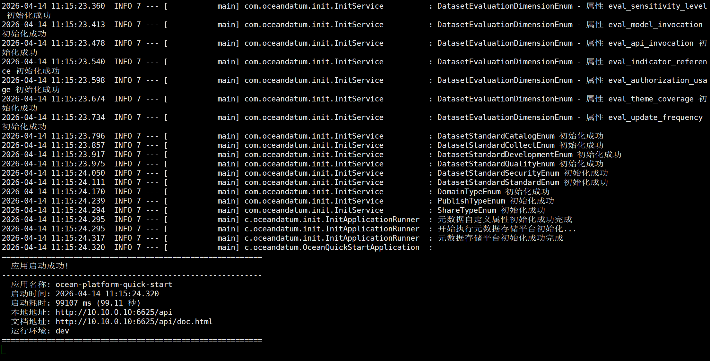

# Ottomi Nexus 安装指南

## 系统要求

| 项 | 要求 |
| :---: | :--- |
| 操作系统 | Linux（Debian / RedHat 系列及兼容国产操作系统） |
| 架构 | X86_64（aarch64 版本后续支持） |
| 最低配置 | 8 核 CPU + 32GB 内存 |

## 前置依赖

Ottomi Nexus V3.0 基于容器化部署，需要提前安装以下组件：

1. **Docker v28.3.3 或更高版本**
   - 安装参考：[Docker 官方文档](https://docs.docker.com/engine/install/)

2. **Docker Compose v2.36.1 或更高版本**
   - 安装参考：[Docker Compose 官方文档](https://docs.docker.com/compose/install/linux/)


## 安装步骤

1. 通过页面地址下载安装包（安装包里面包含了docker-compose.yml 文件，以及一些依赖的初始化目录）

2. 把安装包上传到某个目录进行解压
   ```bash
   tar zxvf ocean.tar.gz
   ```

3. 进入解压后的目录，修改 `docker-compose.yml` 配置文件，需要改变量


4. 启动服务
   ```bash
   docker-compose up -d
   ```

6. 观察ocean-platform 容器的日志（docker logs -f --tail=20 ocean-platform）,看到如下应用启动成功即可
   ```bash
   docker logs -f --tail=20 ocean-platform
   ```


5. 启动完成后，通过浏览器访问平台：
   - 访问地址：`http://服务器IP:6626`
   - 默认账号：`admin`
   - 默认密码：`1qaz@WSX`

> 注意：首次登录后请立即修改默认密码，保障系统安全。
> 


